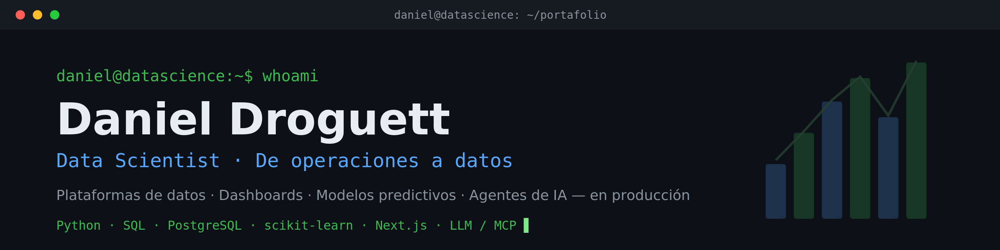

# Hola, soy Daniel Droguett 👋

### Data Scientist · De operaciones a datos

Vengo de 10 años en operaciones y logística, y hoy construyo soluciones de datos de extremo a extremo que las empresas usan a diario. Mi ventaja: entiendo el problema de negocio desde adentro y lo traduzco en decisiones.

🔭 Construyo plataformas de datos, dashboards, modelos predictivos y agentes de IA — **en producción**.
🎓 **Data Scientist graduado del Bootcamp de TripleTen (2026).**
📍 Chillán, Chile.

---

### 🛠️ Stack

**Datos & ML:** Python (pandas, NumPy, scikit-learn, statsmodels, Prophet) · SQL · PostgreSQL/Supabase · ETL (n8n)
**IA aplicada:** Agentes LLM (tool-use) · MCP · Claude API — **Web:** React · Next.js

---

### 🚀 Proyectos destacados

- **El Chillanejo — Plataforma de datos de extremo a extremo** · ERP → PostgreSQL con sync horario, 3 dashboards por rol, +132.000 ventas procesadas. 🌐 [Tienda](https://elchillanejo.cl) · 💬 [Bot WhatsApp con IA](https://wa.me/56987472938)
- **Ramoncita / Tentao — Copilotos de IA para restaurantes** · food cost, ingeniería de menú, mermas y asistente conversacional. ▶ [Ramoncita](https://ramoncita.vercel.app) · ▶ [Tentao](https://tentao-demo-chillan.vercel.app)
- **Forecasting de demanda** · Holt-Winters y SARIMA con backtesting (MAPE), KPIs, Pareto 80/20 y Menu Engineering.

---

### 🔗 Dónde encontrarme

---

